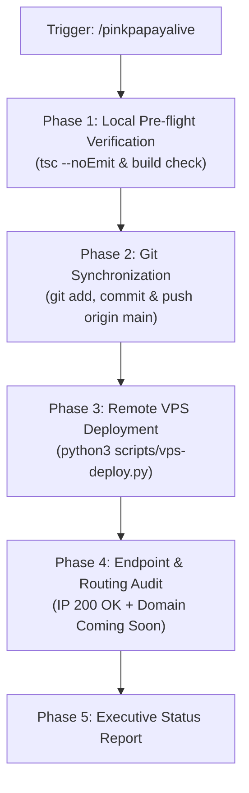

# 🚀 Pink Papaya Live Deployment Workflow (`pinkpapayalive`)

The **`pinkpapayalive`** skill orchestrates the end-to-end production deployment lifecycle for Pink Papaya Stays. It executes local build validation, synchronizes version control with GitHub, triggers remote VPS compilation and PM2 process restarts, and verifies both IP website functionality and production domain "Coming Soon" routing.

---

## 🎯 Trigger Conditions

Activate this workflow whenever:
- The user enters `/pinkpapayalive`
- The user requests to "deploy to live", "deploy to VPS", "push and deploy", or "publish updates to production"
- A production release or hotfix needs to be deployed and verified on the live server

---

## 🔒 Core Routing Architecture & Rules

Before deploying or verifying, ensure the fundamental domain vs. IP routing architecture implemented in `src/middleware.ts` is strictly upheld:

| Channel | URL | Target Experience | Enforced By |
| :--- | :--- | :--- | :--- |
| **Direct VPS IP** | [http://187.127.187.184](http://187.127.187.184) | **Full Live Website & Staff Portals** (`/`, `/stays`, `/admin`, `/cms`) | `src/middleware.ts` (bypasses Coming Soon rewrite for IP & localhost) |
| **Production Domain** | [https://pinkpapayastays.com](https://pinkpapayastays.com) | **Minimal "Coming Soon" Landing Page** | `src/middleware.ts` (rewrites any non-IP/non-localhost domain traffic to `/coming-soon`) |
| **Media & Static** | `/media/*`, `/_next/*`, `/images/*`, `/logo-files/*` | **Pass-Through Asset Delivery** | Nginx `/media/` bypass & Next.js static asset matching |

---

## 🛠️ Step-by-Step Deployment Runbook



### Phase 1: Local Pre-Flight & Build Verification
Ensure the codebase contains zero TypeScript errors, compilation breaks, or missing imports before shipping:
1. Run typecheck / compilation check in the workspace:
   ```bash
   npx tsc --noEmit
   ```
2. If errors or warnings are flagged, resolve them first (or run `/errorfree` or `/pushready` to ensure clean exit code 0).

### Phase 2: Git Synchronization
Stage and push the verified changes to GitHub:
1. Inspect modified files:
   ```bash
   git status
   ```
2. Stage all modifications:
   ```bash
   git add .
   ```
3. Commit with a concise conventional commit message:
   ```bash
   git commit -m "feat/fix: <descriptive message of changes>"
   ```
4. Push to the main branch:
   ```bash
   git push origin main
   ```

### Phase 3: Remote VPS Execution
Deploy to the VPS using the automated deployment runner:
```bash
python3 ./scripts/vps-deploy.py
```
*(Alternatively, run `node ./scripts/vps-deploy.js` which delegates directly to the Python runner).*

**What occurs automatically on the remote VPS (`187.127.187.184`):**
1. Connects to `root@187.127.187.184` over SSH (port 22).
2. Executes as unprivileged user `papaya` inside `/var/www/pink-papaya`:
   ```bash
   su - papaya -c 'cd /var/www/pink-papaya && git fetch origin && git reset --hard origin/main && npm install && npm run build && pm2 restart all && sleep 2 && pm2 list && curl -sI http://localhost:3000'
   ```
3. Fetches the latest commit from `origin/main` and resets the working tree cleanly.
4. Installs production dependencies and compiles Next.js with `npm run build`.
5. Restarts PM2 process (`pink-papaya` app id 0).
6. Verifies local loopback response on `http://localhost:3000`.

### Phase 4: Endpoint Routing & Live Verification
The deploy runner automatically audits public endpoints, or you can verify individually:
1. **Direct IP (Full Website)**:
   ```bash
   curl -sI http://187.127.187.184
   ```
   *Expected*: `HTTP/1.1 200 OK` (Full public website active).
2. **Production Domain (Coming Soon)**:
   ```bash
   curl -sI -H "User-Agent: Mozilla/5.0" https://pinkpapayastays.com
   ```
   *Expected*: `HTTP/2 200` rendering the `/coming-soon` landing page.
3. **Staff Admin Access**:
   Confirm accessibility of [http://187.127.187.184/admin](http://187.127.187.184/admin) and [http://187.127.187.184/cms](http://187.127.187.184/cms).

---

## 📋 Phase 5: Structured Report Back

Conclude the deployment by reporting back to the user with:
- **Deployment Status**: Confirmed PM2 uptime, process PID, and exit code 0.
- **Git State**: Deployed commit hash and message.
- **Clickable Live Links**:
  - 🌐 **Live Website (IP)**: [http://187.127.187.184](http://187.127.187.184)
  - 🔐 **Admin Portal**: [http://187.127.187.184/admin](http://187.127.187.184/admin)
  - 📝 **CMS Portal**: [http://187.127.187.184/cms](http://187.127.187.184/cms)
  - ⏳ **Coming Soon Page (Domain)**: [https://pinkpapayastays.com](https://pinkpapayastays.com)

---

## ⚠️ Troubleshooting & Edge Cases

- **SSH Authentication Timeout**: If SSH password prompts encounter rate limits, wait 5–10 seconds and retry.
- **PM2 Context**: PM2 daemon runs under user `papaya` (`/home/papaya/.pm2`). Always run PM2 commands via `su - papaya -c 'pm2 ...'`.
- **Media Preservation**: Uploaded media lives at `/srv/papaya-media` on VPS disk, outside `/var/www/pink-papaya`, and is served directly by Nginx at `/media/` so it remains persistent across redeploys.
- **Domain Launch Day**: When ready to reveal the live site to the public domain, update the hostname check in `src/middleware.ts` and set `secure: true` on the auth cookie in `src/lib/auth.ts`.
